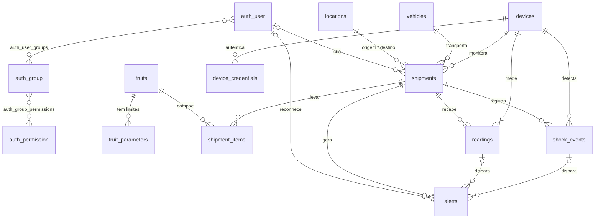

# Modelo de dados (banco oficial)

O banco é gerado pelas migrations do Django a partir dos `models.py`. Este é o modelo
que está no PostgreSQL (Neon). Diagrama: [`DER.png`](DER.png) (fonte em [`der.mmd`](der.mmd);
o GitHub também desenha o bloco abaixo).

Notação pé de galinha: `||` exatamente um · `|o` zero ou um · `o{` zero ou muitos.

## Correções no DER anterior (brModelo)

No DER anterior, as cardinalidades dos relacionamentos 1:N estavam do lado trocado.
Na notação do brModelo, a cardinalidade escrita junto de uma entidade diz quantas
ocorrências **dela** se ligam a uma ocorrência da outra.

| Relacionamento | Como estava | Correto | Leitura correta |
|---|---|---|---|
| `local` — `recebe_alocacao` — `alocacao_dispositivo` | local (0,n) · alocação (1,1) | local **(1,1)** · alocação **(0,n)** | Um local recebe várias alocações; cada alocação é de um local |
| `dispositivo` — `possui_alocacao` — `alocacao_dispositivo` | dispositivo (0,n) · alocação (1,1) | dispositivo **(1,1)** · alocação **(0,n)** | Um dispositivo passa por várias alocações; cada alocação usa um dispositivo |
| `alocacao_dispositivo` — `registra_medicao` — `medicao` | alocação (0,n) · medição (1,1) | alocação **(1,1)** · medição **(0,n)** | Uma alocação tem várias medições; cada medição pertence a uma alocação |
| `medicao` — `gera` — `alerta` | medição (0,n) · alerta (1,1) | medição **(1,1)** · alerta **(0,n)** | Uma medição gera zero ou mais alertas; cada alerta vem de uma medição |
| `dispositivo` — `possui` — `configuracao_limite` | dispositivo (0,n) · configuração (1,1) | dispositivo **(1,1)** · configuração **(0,n)** | Com `data_inicio`/`data_fim`, há várias configurações ao longo do tempo |
| `usuario` — `possui_perfil` — `perfil` | usuário (1,n) · perfil (0,n) | usuário **(0,n)** · perfil **(1,n)** | Todo usuário tem ao menos um perfil; um perfil pode estar sem usuários |
| `perfil` — `tem_permissao` — `permissao` | perfil (1,n) · permissão (0,n) | perfil **(0,n)** · permissão **(1,n)** | Todo perfil tem ao menos uma permissão; uma permissão pode estar sem perfil |

## Do DER anterior para o banco atual

O banco atual cobre tudo o que o DER anterior tinha e acrescenta o que o plano técnico
exige (viagem, fruta, carga, impacto, credencial da placa).

| DER anterior | Banco atual | Diferença |
|---|---|---|
| `usuario`, `perfil`, `permissao` | `auth_user`, `auth_group`, `auth_permission` (Django) | Sistema nativo do Django: senha com hash, sessões e permissões prontas. `perfil` = grupo; `recurso` + `acao` = `content_type` + `codename` |
| `local` | `locations` | Igual |
| `dispositivo` | `devices` | `codigo` virou `uid`; ganhou última comunicação, tipo de conexão e SSID |
| `alocacao_dispositivo` | `shipments` (viagem) | A viagem liga dispositivo, veículo, origem e destino, com início e fim |
| `configuracao_limite` (por dispositivo) | `fruit_parameters` (por fruta) | O limite depende da fruta, não da placa (plano, seção 4). Ganhou impacto máximo |
| `medicao` | `readings` | `origem` virou `network`; ganhou `sequence` (contra duplicação) e `impact_peak_g` |
| `alerta` | `alerts` | `nivel` = `severity`; guarda valor medido e limite violado; pode vir de leitura ou impacto |
| — | `vehicles`, `fruits`, `shipment_items` | Novos: veículo, fruta e carga da viagem |
| — | `shock_events` | Novo: impactos detectados entre as leituras |
| — | `device_credentials` | Novo: chave da placa (só o hash) |

## Regras garantidas pelo banco

- `UNIQUE(device_id, sequence)` em `readings` e `UNIQUE(device_id, event_id)` em `shock_events`: reenvio da placa não duplica.
- Índice único parcial: no máximo 1 viagem `active` por dispositivo; 1 parâmetro ativo por fruta; 1 alerta ativo por viagem e tipo.
- CHECKs: umidade entre 0 e 100; temperatura entre −40 e 80 °C; impacto ≥ 0; mínimo < máximo nos parâmetros; origem ≠ destino; fim depois do início; quantidade > 0; todo alerta tem leitura ou impacto de origem.
